# Agentic Coding Template

一套让 Claude Code / Codex 按**「先计划、再实现、带证据交付」**工作的项目模板。
它从一个真实生产项目的工作流中提炼而来：项目规则、计划文档规范、执行与评审 skill、PR 交接清单，
以及高风险改动的「理解关卡」（讲回 + 模拟飞行）。

## 工作流一览

```mermaid
flowchart LR
  A[需求] --> B[writing-plans<br/>docs/plans 主文档 + 子任务]
  B --> C{负责人确认<br/>高风险：讲回}
  C --> D[executing-plans<br/>TDD 执行 · 偏离即回写计划]
  D --> E[验证<br/>test-critical-scope → test-critical<br/>计划机械验收契约]
  E --> S[高风险：模拟飞行<br/>记录提交进计划]
  S --> F[code-review-request<br/>本地评审子代理 · 报告落盘]
  F --> G[code-review-response<br/>核实后再改 · 查同类]
  G -->|有 🔴| F
  G -->|无 🔴| H[mark-review-passed<br/>记录 HEAD]
  H --> I[pr-ready<br/>不变量表 · 回滚 · 上线八维度]
  I --> J[PR / 合并<br/>CI：scope · workflow · test-critical]
  J --> K[pr-lessons<br/>合并后复盘 → lessons.md]
  K -.沉淀.-> R[RULES.md / skills]
```



核心原则：

- **`RULES.md` 是唯一的规则源**：开发看它，评审看它，`REVIEW.md` 只负责把规则映射到严重度。
- **计划是给两类读者写的**：主文档写给确认计划的人看（决策、风险、兼容性、上线），子任务文档写给执行者看（完整代码、命令、预期输出）。
- **证据先于结论**：只报有直接证据的结果；实现、测试、评审、部署、生产五种状态分开说。
- **单一事实源**：同一业务事实只有一个写入方，计划不复制第二份规范。

## 包含什么

| 位置 | 内容 |
|---|---|
| `CLAUDE.md` / `AGENTS.md` | Claude Code 与 Codex 的入口，都指向 `RULES.md` |
| `RULES.md` | 9 条硬规则：契约消费方、语义漂移、多端兼容、存量数据处理、迁移带数据验证、文档白名单、禁改 `.env`、验证匹配风险、防重复事实 |
| `REVIEW.md` | 🔴/🟡/🟣 分级、数量上限、规则映射、多轮收敛规则 |
| `skills/` | 项目 skill（见下表），`scripts/install-skills.sh` 安装到 `.claude/skills` 与 `.codex/skills` |
| `.claude/settings.json` + `.claude/hooks/` | 项目钩子 `require-local-review`：当前 HEAD 没有本地 review 通过记录时拦截 `gh pr create`，clone 即生效（需要 `jq`） |
| `docs/` | 编号核心文档骨架、`plans/`（领域 → 主题，附一份已上线主题的样板 `governance/daily-pr-lessons`）、`agents/`（教训、规则背后的事故记录 `rules-evidence.md`、上线八维度、issue/标签约定、术语、skill 依赖） |
| `Makefile` + `.github/scripts/` | `make test-critical-scope`：按改动路径判断是否必须跑核心测试，可沿用一次全绿运行；`make test-workflow`：工作流自身的测试；`make audit-plans`：计划目录审计 |
| `.github/workflows/` | `ci.yml`（scope / workflow / test-critical 三个 job 的最小骨架）、`daily-pr-lessons.yml`（每日复盘，见计划样板 §10 启用） |
| `plugins.txt` | 依赖的第三方插件清单（不复制代码，由 `bootstrap.sh` 安装） |

### 项目 skill

| Skill | 作用 |
|---|---|
| `writing-plans` | 写计划：§0 决策卡、主文档 + 子任务，流程图/时序图/状态机，多端兼容矩阵，上线八维度，完成对账与机械验收契约；高风险计划实施前讲回 |
| `executing-plans` | 执行计划：计划关卡 → TDD 执行（关键决策变更即重新讲回）→ 完成核对 → 计划回写 |
| `code-review-request` | 派一个评审子代理，报告**先落盘**，防止子代理空转丢报告 |
| `code-review-response` | 先核实再修改，按阻塞 → 机械 → 结构顺序修，修完查同类 |
| `pr-ready` | 发 PR 前关卡（高风险模拟飞行、本地评审循环）+ PR 描述清单：不变量与故障拦截表、残余风险、回滚、上线步骤 |
| `ci-fix` | 复现 → 定位 → 最小修复 → 最小充分验证 |
| `pr-lessons` | 每日复盘合入的 PR，每周把反复出现的教训沉淀进规则（带脚本与测试） |
| `organizing-plans` | 计划目录按领域整理、归档已上线主题、链接审计（带脚本与测试） |

线上排查与发布流程和部署形态强相关，模板不提供；按项目需要自建 skill，并在 `CLAUDE.md` 里引用。

### 理解关卡

团队统一执行。「高风险」的唯一定义在 `docs/agents/high-risk.md`，模块清单是占位符 `{{HIGH_RISK_DOMAINS}}`，按项目填写。
「负责人」指推动本次改动、确认计划的人。

- **规划**：每个计划都有 §0 决策卡（关键决策、掌控分级、可能让你意外的地方）。高风险计划实施前，负责人要**用自己的话**讲清每个关键决策和「必须人理解」项（讲回 / explain-back），按轮次表记录在「确认记录」里；其他计划写「不适用」及理由。
- **执行**：高风险计划的关键决策变更时暂停，只对变更项重新讲回；「交给验证兜底」的每一项都要核对检查确实存在并跑绿。
- **发 PR 前**：高风险计划先做「模拟飞行」（数据流 + 注入故障题，答对且有通过的测试覆盖才算过），记录提交进计划；然后每个 PR 跑本地评审循环直到没有 🔴（最后一轮只记在 PR 描述里，不再提交），再用 `skills/pr-ready/scripts/mark-review-passed.sh` 记录 HEAD。项目钩子在没有记录、带 `--head` 或缺 `jq` 时拦截 `gh pr create`；它不拦截向已有 PR 的 `git push`。Codex 无钩子，按 `pr-ready` 手动执行。CI 工作流创建的 PR 不走这个循环。

## 快速开始

```bash
# 1. 用模板创建新仓库
gh repo create my-org/my-project --template codingDuan/agentic-coding-template --private --clone
cd my-project

# 2. 填核心占位符、安装项目 skill 与第三方插件
bash bootstrap.sh --name "My Project" --slug my-project --repo my-org/my-project

# 3. 按脚本最后列出的剩余 {{...}} 占位符逐个填写，然后开新会话
```

`bootstrap.sh` 结束时会列出所有剩余的 `{{...}}` 占位符，主要有：`RULES.md` §1（环境等价规则）、§3 客户端清单、
`REVIEW.md` 的关键链路、`docs/agents/high-risk.md` 的高风险模块清单、`docs/09-test-guide.md` 的测试命令、`Makefile` 的 `TEST_CRITICAL_CMD`。

此外有两处没有占位符、但需要按项目改写的配置：

- `skills/pr-lessons/scripts/high-risk.json`：哪些路径算高风险（复盘必看），默认是通用关键词。与 `docs/agents/high-risk.md` 的模块清单保持一致。
- `.github/scripts/classify-ci-scope.sh` 的 client 行：客户端代码目录（同步改 `test-classify-ci-scope.sh`）。

## 依赖的第三方插件

| 插件 | 必需 | 用途 |
|---|---|---|
| [superpowers](https://github.com/obra/superpowers) | 是 | `executing-plans` 等委托给它的子代理开发、完成前验证、分支收尾、worktree |
| code-review（官方） | 否 | 临时 PR 评审 |
| [mattpocock/skills](https://github.com/mattpocock/skills) | 否 | TDD、调试、grilling、领域建模 |
| [plannotator](https://github.com/backnotprop/plannotator) | 否 | 讲回时的计划批注 |

同名 skill 的说明（项目版 `executing-plans` 和 `superpowers:executing-plans` 不是一回事）见 `docs/agents/skill-dependencies.md`。

## 定制建议

- 新踩的坑先进 `docs/agents/lessons.md`；反复出现或代价高的再升级成 `RULES.md` 条目或 skill 规则。改 `RULES.md` 时同步 `REVIEW.md` 的映射表。
- 改 skill 后运行 `bash scripts/install-skills.sh`，并开新会话。
- 新踩的坑的「为什么」写进 `docs/agents/rules-evidence.md`，`RULES.md` 只保留规范条文。
- 不需要的 skill 直接删目录，再更新 `CLAUDE.md` 和 README 中的引用。

## License

MIT。第三方插件按各自的 License 由其上游分发，本仓库不包含它们的代码。
