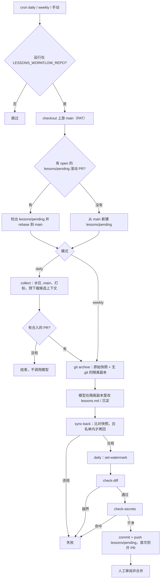
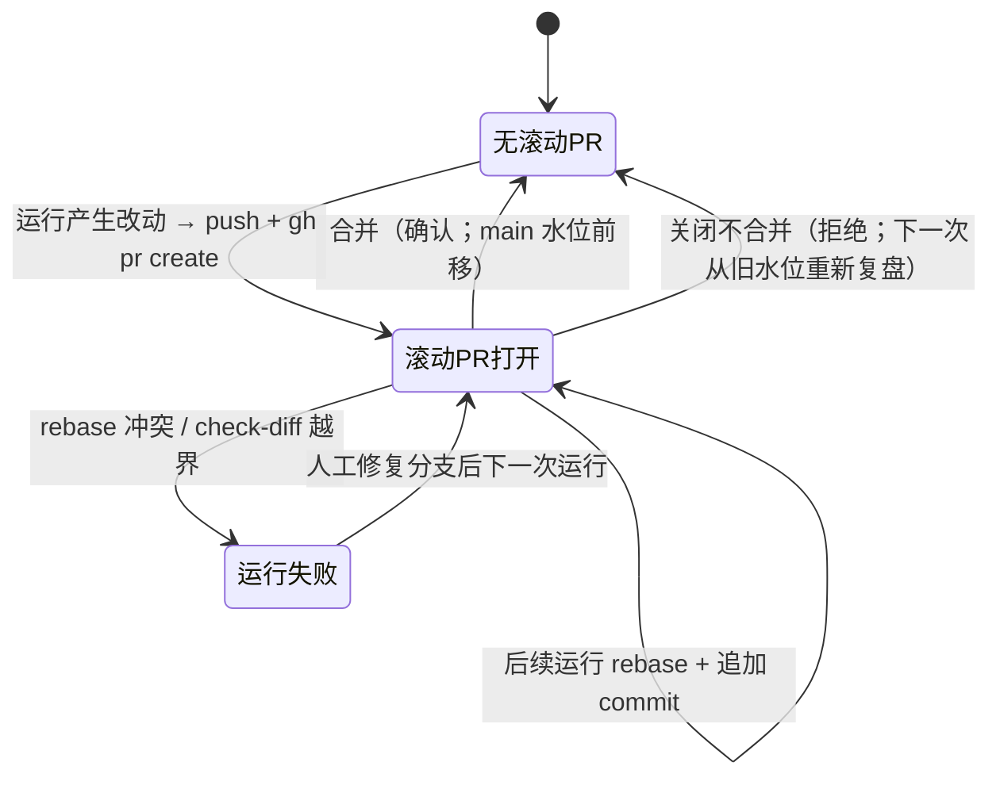

# 每日 PR 复盘 → lessons 沉淀机制

> **For agentic workers:** REQUIRED SUB-SKILL: Use executing-plans (this repo's, not
> superpowers:executing-plans) — its plan gate and completion steps apply to every execution mode.

> 状态：已在源项目上线；模板随附代码、测试与 workflow，新项目只需完成 §10 的配置。
> 本文同时是一份**已上线主题的计划样板**：子任务文档在上线后已按 `organizing-plans` 压缩进本文并删除，
> 新计划的结构参照 `skills/writing-plans/SKILL.md`。

## 0. 决策卡

### 关键决策

| # | 决策点 | 选择 | 否掉的备选及原因 | 选错的代价 |
|---|---|---|---|---|
| D1 | 定时任务在哪跑、用谁的模型 | **GitHub Actions**（`LESSONS_WORKFLOW_REPO`，可以是上游仓库本身，也可以是个人 fork），每天一次 daily、每周一一次 weekly。模型由 repo variable `LESSONS_PROVIDER` 切换：`claude`（`claude setup-token` 订阅 token）或 `deepseek`（Anthropic 兼容接口，按量付费） | 本机 cron：电脑不开就漏跑，依赖个人环境。云端定时 agent：prompt 和调度不入库，凭据和审计不如 workflow 透明 | 在 fork 上跑时，fork 的 main 没同步就会跑旧 workflow（skill 和脚本取自上游 main，不受影响）；账单停摆时静默停跑，只有 GitHub 的失败邮件提醒 |
| D2 | 「教训」的筛选标准 | **两段式**：脚本先对每个 PR 做确定性打标（§2 筛选表），带标记的 PR 交给模型判断「是否存在一条事前能拦住它的规则」；没有就只记一行「无教训（理由）」 | 把全部 PR 交给模型自由提炼：写成流水账，成本随 PR 数线性增长，也无法事后审计「为什么这个 PR 没被复盘」 | 打标漏掉的坏 PR 不会被复盘。标记规则在脚本里，高风险路径在 `skills/pr-lessons/scripts/high-risk.json`，可以迭代 |
| D3 | 怎么知道复盘到哪了 | **水位** `<!-- reviewed-through: <sha> (<date>) -->` 写在 `lessons.md` 首行，由脚本读写，模型不碰；每次复盘 `水位..origin/main` 区间 | 按「昨天」的日期窗口：漏跑一天就丢一天，补跑会重复 | 水位写错会重复复盘或跳过一段；`set-watermark` 只接受 collect 输出的 head |
| D4 | 谁确认、怎么确认 | **一个滚动 PR**（分支 `lessons/pending` → `main`）：每天追加一个 commit，周一的 fold 把教训沉淀进 `RULES.md` / 模块 README / skill。**合并即确认，关闭不合并即拒绝** | 每天一个 PR：噪音太大。直推 main：绕过人工确认 | 一直不合并会持续堆积；关闭后下一次从 main 上的旧水位重新复盘同一批 PR（§5） |
| D5 | 模型的权限边界 | 模型**在隔离副本里只改文件，拿不到任何 GitHub token**。`git archive` 导出一份没有 `.git` 的副本作为工作目录，只有 Read / Edit / Grep / Glob，`dontAsk` 模式，关闭 hooks，禁止读工作目录以外的文件。PR 上下文由 collect 预先下载。可信步骤 `sync-back` 逐字节比对副本和原始快照，白名单内的修改才拷回。commit、push、开 PR 都由 workflow 步骤完成，再加 `check-diff` 和 `check-secrets` 两道检查。校验脚本放在 `$RUNNER_TEMP`，每次使用前核对 sha256 | ① 让模型自己 `git push` / `gh pr create`：被 PR 正文误导后能写到任意位置。② 给模型 token、只放行 `gh pr view/diff`：执行不了命令不等于拿不走 token。③ 在真实仓库里运行：模型能改校验脚本、`$GITHUB_ENV`、`.git/hooks`，后续持有凭据的步骤会执行它写的东西 | weekly 模式允许改 `RULES.md`，错误的规则只能靠合并前的人工审阅兜底 |

### 判定规则（一句话版）

- **谁会被复盘**：只看风险信号，不看 bug 还是 feat。命中任一条即复盘：回滚；修 14 天内刚合入的改动；改了高风险路径（无论是否有计划）；带着签字放行或 CI 未启动合入。其余 PR 只计数。
- **何时沉淀、去哪**：出现在 **≥3 个不同日期**（同一天多次只算一天），或**只出现一次但代价高**（资损、生产或预发不可用、错误数据写入生产、权限越界）。跨模块规则进 `RULES.md`（原因与事故进 `docs/agents/rules-evidence.md`），模块专属进模块 README，流程纪律进对应 skill。已经在 `RULES.md` 里的规则再出现算**复发**，不新增教训。
- **复盘范围**：从水位到当前 main，不按日期算。停跑几天，恢复后一次补齐；关闭滚动 PR 后水位不前移，会重新复盘同一批 PR。
- **daily 和 weekly 各做什么**：daily 只复盘新合入的 PR、写教训。weekly **不看 PR**，只整理已有教训：够门槛的沉淀出去，把 7 天前的日志压缩成一行周汇总。

### 掌控分级

| 必须人理解（人对其负责） | 交给验证兜底（谁会抓住错误） |
|---|---|
| 筛选标准：哪些 PR 进入复盘、哪些只计数（§2 筛选表） | 水位读写：`WatermarkTest` |
| 沉淀门槛与去向（§2 沉淀表） | 高风险路径配置与候选打标：`HighRiskConfigTest`、`ClassifyTest` |
| 确认点：合并滚动 PR = 确认，关闭 = 拒绝并重跑（§5） | 改动路径白名单：`CheckPathsTest` + workflow 的 `check-diff` 步骤 |
| 凭据边界：PAT 只出现在 collect、prepare 和 push 步骤，模型步骤的环境里没有它（§7） | 密钥外泄：`LeakTest`、`ExtraFileLeakTest` + workflow 的 `check-secrets` 步骤 |
| | 隔离副本拷回：`WorkspaceSyncTest`（`.git/hooks` 注入、新增或改过的符号链接、删除、daily 改 RULES 都被拒） |
| | 上下文预下载、超大 diff、关联 PR：`RelatedTest`、`TruncateTest`、`CollectTest`、`TooLargeDiffTest` |

### 可能让你意外的地方

- **workflow 只在 `LESSONS_WORKFLOW_REPO` 上运行**（`if: github.repository == ...`）。上游仓库 Actions 不可用时，可以放在个人 fork 上跑，复盘对象仍是上游，需要一个对上游可读、可开 PR 的 PAT。
- **在 fork 上跑时，workflow yml 来自 fork main，skill 和脚本来自上游 main。** 改了 workflow 之后要把上游 main 同步到 fork main，这是一个长期运维动作。
- **关闭滚动 PR 不等于跳过。** 想跳过一段，用 `since` 输入手动运行一次。
- **首跑要手动 backfill**：水位为空时 collect 会报错，用 `since=<sha>` 手动运行一次。
- **周 fold 会改 `RULES.md`。** 那是 review 的 🔴 依据，合并滚动 PR 前要逐条看。
- **高风险路径是项目相关的。** `high-risk.json` 不改，复盘会按模板的通用关键词判断，可能漏掉本项目的高风险模块。

## 1. 问题背景 / 目标

不写计划的单点修复（`CLAUDE.md` 允许）即使落在支付、权限、通知、迁移这些高风险领域，也不经过计划确认和模拟飞行。需要一个事后机制覆盖它们，并把学到的东西回流到规则里。

**目标**

1. 每天自动复盘前一天合入 `main` 的 PR，覆盖所有高风险改动，教训写进 `docs/agents/lessons.md`。
2. 每周把反复出现或代价高的教训沉淀进 `RULES.md` / `rules-evidence.md`、模块 README 或 skill。
3. 让 lessons 在动手前被读到：`CLAUDE.md` 导航和 `writing-plans` 的前置阅读都指向它。

**非目标**：不在发 PR 前加关卡；不复盘 open PR、不评论 PR、不打标签。

## 2. 解决策略 / 设计原则

**筛选表（D2，`pr_lessons.py classify`）**

| 标记 | 判定 | 是否候选 |
|---|---|---|
| `revert` | 标题以 `Revert` 开头 | 是 |
| `fix_of_recent` | 标题是 `fix` / `hotfix`，且（与 14 天内合入的 PR 有非文档文件重叠，**或**正文引用了 14 天内合入的 PR 号） | 是 |
| `high_risk` | 改到 `high-risk.json` 定义的高风险路径 | 是；有计划不构成豁免 |
| `high_risk_no_plan` | 同上，且正文和 diff 里都没有 `docs/plans/` | 是；用于区分缺少计划 |
| `signoff_or_ci_skipped` | 正文含「签字放行：」或「CI 未启动」 | 是 |
| 无标记 | — | 否，只在日志行里计数 |

候选 PR 交给模型后，模型只回答一个问题：**「合并前遵守哪条规则就能拦住它，或更早发现它？」** 答得出就写一条教训，答不出就记一行「#N 无教训（理由）」。

**沉淀表（周 fold，D4）**

| 条件 | 去向 |
|---|---|
| 出现 ≥3 个不同日期，或代价高 | 跨模块、违反即 🔴 → `RULES.md` 条文 + `docs/agents/rules-evidence.md` 事故记录 |
| 同上 | 模块专属 → 模块 `README.md` 或 `docs/NN-*.md` |
| 同上 | 流程纪律 → `skills/<name>/SKILL.md` |
| 已沉淀的规则又出现 | 不新增教训；在「已沉淀」行追加「复发 日期 #N」 |

沉淀只**增加**，不删减、不弱化 `RULES.md` 已有内容。

## 3. 流程图



## 5. 状态机

唯一信息源是 **main 上 `lessons.md` 的水位**，加上 **`lessons/pending` 有没有 open 的滚动 PR**。



## 6. 数据流

- **输入**：main 的 first-parent 提交区间 `水位..main`；每个 PR 的元数据与改动文件；最早合入时间往前 14 天内合入的 PR 列表。
- **中间产物**（不入库）：`$RUNNER_TEMP/candidates.json`；`$RUNNER_TEMP/context/pr-N.json`、`pr-N.diff`（单个 diff 超过 200 KB 截断）；commit message。
- **持久化**：`docs/agents/lessons.md`；周 fold 还会写 `RULES.md`、`docs/agents/rules-evidence.md`、模块 README 或 `skills/*/SKILL.md`。只经过滚动 PR 进入 main。

## 7. 凭据边界

| Secret（`LESSONS_WORKFLOW_REPO` 上） | 用途 | 最小权限 |
|---|---|---|
| `LESSONS_GH_TOKEN` | checkout、`gh pr view/diff/list/create` | 对上游可读、可开 PR；只出现在不跑模型的步骤里 |
| `CLAUDE_CODE_OAUTH_TOKEN` | `LESSONS_PROVIDER=claude` 时使用 | 不用 claude 就不配 |
| `DEEPSEEK_API_KEY` | `LESSONS_PROVIDER=deepseek` 时使用 | 单独建一个 key，便于限额和吊销 |
| `GITHUB_TOKEN`（自动提供） | push `lessons/pending` | `contents: write` |

模型步骤只声明当前 provider 的那一个模型凭据，不声明任何 GitHub 凭据。**模型够得着的范围里，没有任何会被后续步骤执行的东西**：校验脚本和 `$GITHUB_ENV` 在 `$RUNNER_TEMP`（工作目录外，`dontAsk` 下 Edit 被拒）；隔离副本里没有 `.git`；拷回的文件由 `sync-back` 比对得出，删除和符号链接一律拒绝；commit message 经过 `check-secrets` 扫描。

**为什么「执行不了」不够**：只限制模型能执行哪些命令、不限制它能读到什么时，它可以读出环境里的 token，再写进允许改的 `lessons.md`，由 workflow 自动提交出去。路径白名单拦不住，因为 `lessons.md` 本来就在白名单里。

## 9. 验证

```bash
python -m pytest skills/pr-lessons/scripts/tests -q
python -c "import yaml; yaml.safe_load(open('.github/workflows/daily-pr-lessons.yml')); print('ok')"
# 本地对真实仓库跑一次 collect（只读）
python skills/pr-lessons/scripts/pr_lessons.py collect --since <sha> --repo <owner/repo>
```

## 10. 上线步骤与回滚

1. 替换 workflow 里的 `{{GITHUB_REPO}}`、`{{LESSONS_WORKFLOW_REPO}}`、`{{LESSONS_FORK_OWNER}}`（不用 fork 时后两者填上游仓库和它的 owner）。
2. 按本项目改写 `skills/pr-lessons/scripts/high-risk.json`，跑测试。
3. 在 `LESSONS_WORKFLOW_REPO` 配置 §7 的 secrets；可选 repo variables：`LESSONS_PROVIDER`、`LESSONS_MODEL`。
4. 手动运行 `mode=daily, since=<起点 sha>, dry_run=true`，看日志里的 candidates 和 diff。
5. 去掉 `dry_run` 再跑一次，审阅生成的滚动 PR；之后交给 cron。

**回滚**：在 Actions 页面 disable 这个 workflow（立即生效）。已合并进 main 的 lessons / RULES 条款不会自动还原，需要单独 revert 对应的滚动 PR 合并提交；未合并的滚动 PR 直接关闭。

## 12. 踩坑记录

| 问题 | 根因 | 解决方案 |
|------|------|----------|
| 最初让模型持有 `GH_TOKEN`，只限制可执行命令 | 「执行不了」≠「拿不走」 | 模型步骤不注入任何 GitHub 凭据，上下文由 collect 预下载；提交前跑 `check-secrets` |
| 校验脚本副本、`$GITHUB_ENV`、`.git/hooks` 在模型可写范围内 | 把「模型能改哪些文件」当成路径白名单问题，忽略了后续持凭据步骤会执行模型写的东西 | 隔离副本 + `sync-back` + sha256 核对 + `dontAsk` / `disableAllHooks` / `blockReadsOutsideWorkingDirectories` + `core.hooksPath=/dev/null` |
| commit message 没有经过密钥扫描 | `check-secrets` 只扫仓库 diff | `--extra-file` 扫描 commit message；`sync-back` 只拷普通文件 |
| 定义签字机制的 PR 被误标为签字放行 | 正文里的模板表头被子串匹配误中 | 收紧为 `签字放行：(?!.*<item>)`，补回归测试 |
| 正文里的 `Closes #N` 让整次 collect 失败 | 关联号可能是 issue | 确认不是 PR 才跳过（`related_missing`），其他错误一律中止 |
| 靠标题 `(#N)` 识别 PR | rebase-merge 和手改标题会让它失效 | 用 `commits/{sha}/pulls` 关联，标题解析只作兜底 |
| 高风险路径只匹配 `services/` | 支付逻辑分散在 routers、models、integrations 和各端页面 | 对 scopes 下的非测试文件做关键词匹配，配置在 `high-risk.json` |
| 所有 `.md` 都被当成文档 | 运行时 Markdown 是产品内容 | 文档只认 `docs/`、`skills/` 和根目录元文档 |
| `gh pr list --head` 不区分 fork 所有者 | `--head` 只按分支名过滤 | 按 `headRepositoryOwner` 筛选 |
| 超大 PR 的 `gh pr diff` 返回 HTTP 406 | 确定性失败会让每天的运行永久卡住 | 识别 too_large 后改用 `pulls/{n}/files` 逐文件 patch，并标注「不完整」 |
| 换项目后高风险关键词仍是源项目的业务词 | 关键词写死在脚本常量里 | 抽到 `high-risk.json`，缺文件或空列表直接报错 |
